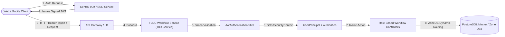
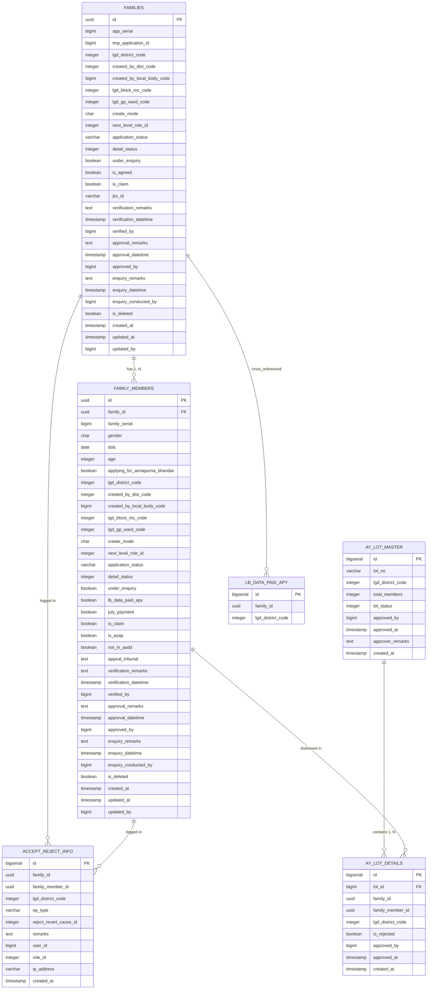

# FLDC / Annapurna Yojana (APY) Workflow Module
## Comprehensive API & Database Specification

**Application Name**: FLDC Process Application (Workflow & Status Update Microservice)  
**Target Runtime**: Java 21 LTS | Spring Boot 3.x / 4.x | PostgreSQL 15+  
**Specification Version**: 2.0.0 (Production-Ready)  
**Last Updated**: November 2026  

---

## Table of Contents
1. [Architecture & System Context](#1-architecture--system-context)
   - [Microservice Scope: Workflow & Status Engine Only](#11-microservice-scope-workflow--status-engine-only)
   - [Centralized IAM & JWT Bearer Authentication](#12-centralized-iam--jwt-bearer-authentication)
   - [JWT Claims Structure](#13-jwt-claims-structure)
   - [Multi-Tenant / ZoneDB Routing](#14-multi-tenant--zonedb-routing)
   - [Request MDC & Audit Tracking](#15-request-mdc--audit-tracking)
2. [Database Architecture & Updated Schemas](#2-database-architecture--updated-schemas)
   - [Entity-Relationship Diagram](#21-entity-relationship-diagram)
   - [Schema: `dbt_apy`](#22-schema-dbt_apy)
     - [`dbt_apy.families`](#221-dbt_apyfamilies)
     - [`dbt_apy.family_members`](#222-dbt_apyfamily_members)
     - [`dbt_apy.accept_reject_info`](#223-dbt_apyaccept_reject_info)
   - [Schema: `cross_check`](#23-schema-cross_check)
     - [`cross_check.lb_data_paid_apy`](#231-cross_checklb_data_paid_apy)
     - [`cross_check.ay_lot_master`](#232-cross_checkay_lot_master)
     - [`cross_check.ay_lot_details`](#233-cross_checkay_lot_details)
   - [Database Indexes & Optimization](#24-database-indexes--optimization)
3. [Workflow State Machine & Business Rules](#3-workflow-state-machine--business-rules)
   - [Role ID Reference Table (-106 to 30)](#31-role-id-reference-table--106-to-30)
   - [State Transition Matrix](#32-state-transition-matrix)
   - [Core Business Invariants](#33-core-business-invariants)
4. [Queue Filtering & Tab-Based Navigation](#4-queue-filtering--tab-based-navigation)
   - [Enquiry Officer Tabs (1 to 5)](#41-enquiry-officer-tabs-1-to-5)
   - [Verifier Tabs (1 to 9)](#42-verifier-tabs-1-to-9)
   - [Approver Queue](#43-approver-queue)
   - [LGD Jurisdiction Scoping](#44-lgd-jurisdiction-scoping)
5. [Standard API Responses & Error Handling](#5-standard-api-responses--error-handling)
   - [Unified Response Wrapper (`ApiResponse<T>`)](#51-unified-response-wrapper-apiresponset)
   - [Paginated Queue Wrapper (`PageResponse<T>`)](#52-paginated-queue-wrapper-pageresponset)
   - [Global Error Envelope & ErrorCode Master](#53-global-error-envelope--errorcode-master)
6. [API Endpoints Reference](#6-api-endpoints-reference)
   - [6.1 Citizen Workflow APIs](#61-citizen-workflow-apis)
   - [6.2 Operator Workflow APIs](#62-operator-workflow-apis)
   - [6.3 Enquiry Officer Workflow APIs](#63-enquiry-officer-workflow-apis)
   - [6.4 Verifier Workflow APIs](#64-verifier-workflow-apis)
   - [6.5 Approver Workflow APIs](#65-approver-workflow-apis)
   - [6.6 Post-Rejection Reprocess (Admin) APIs](#66-post-rejection-reprocess-admin-apis)
   - [6.7 Batch Payment Lot APIs](#67-batch-payment-lot-apis)
   - [6.8 Backward-Compatibility Legacy Endpoints](#68-backward-compatibility-legacy-endpoints)

---

## 1. Architecture & System Context

### 1.1 Microservice Scope: Workflow & Status Engine Only
This service is dedicated exclusively to **Workflow Execution, Status Mutations, Tab-Based Queues, and Immutable Audit Logging** for the Annapurna Yojana (APY) / FLDC initiative.

> [!IMPORTANT]
> **No Authentication Microservice Inside This Service**:
> - There are **NO** login, user registration, token generation, or credential management endpoints.
> - Authentication is externalized to a central Identity and Access Management (IAM) / Single Sign-On (SSO) gateway.
> - This service runs purely as an **OAuth2 / JWT Resource Server** that validates pre-signed JWT tokens presented in incoming HTTP `Authorization` headers.



### 1.2 Centralized IAM & JWT Bearer Authentication
Every non-public HTTP request must include a standard RFC 6750 Bearer token:
```http
Authorization: Bearer <JWT_TOKEN>
```
If the token is missing, expired, or cryptographically invalid, the service terminates the request with HTTP `401 Unauthorized` and `ErrorCode.UNAUTHORIZED`.

### 1.3 JWT Claims Structure
The incoming JWT token payload must conform to the following schema:

```json
{
  "sub": "100234",
  "userId": 100234,
  "username": "op_guwahati_01",
  "roles": [
    "ROLE_OPERATOR"
  ],
  "office": "CSC Centre Dispur",
  "districtCode": 304,
  "blockCode": 2145,
  "gpCode": 10982,
  "localBodyCode": 880192,
  "iss": "nic-apy-iam",
  "exp": 1794508800,
  "iat": 1762972800
}
```

#### Supported Claim Aliases
To ensure interoperability across various state portal token emitters, `JwtTokenProvider` resolves claims using standard fallbacks:
| Canonical Field | Supported Token Claim Aliases | Description |
| :--- | :--- | :--- |
| `userId` | `userId`, `user_id`, `sub` | Numeric unique identifier of officer/citizen |
| `districtCode` | `districtCode`, `lgd_district_code`, `district_id` | LGD District Code (mandatory for scoping) |
| `blockCode` | `blockCode`, `lgd_block_mc_code` | LGD Block / Municipality Code |
| `gpCode` | `gpCode`, `lgd_gp_ward_code` | LGD Gram Panchayat / Ward Code |
| `localBodyCode` | `localBodyCode`, `created_by_local_body_code` | Local body identifier |
| `office` | `office` | Office / CSC name string |
| `roles` | `roles`, `role` | Array of strings (e.g. `["ROLE_VERIFIER"]` or `["VERIFIER"]`) |

#### Role Mapping
- `ROLE_CITIZEN` / `CITIZEN`
- `ROLE_OPERATOR` / `OPERATOR`
- `ROLE_ENQUIRY_OFFICER` / `ENQUIRY_OFFICER`
- `ROLE_VERIFIER` / `VERIFIER`
- `ROLE_APPROVER` / `APPROVER`
- `ROLE_ADMIN` / `ADMIN` (Super administrative privileges)

### 1.4 Multi-Tenant / ZoneDB Routing
The legacy system routes database operations across regional database partitions ("Zones") keyed on District Code. This architecture preserves dynamic multi-zone database routing using Spring's `AbstractRoutingDataSource`:
1. `ZoneContextHolder`: Thread-local storage capturing the target database zone key (e.g. `zone1`, `zone2`).
2. `ZoneRoutingDataSource`: Resolves the active connection pool per transaction.
3. Fallback: If no explicit zone is requested, the system automatically resolves the zone using the `districtCode` in the request DTO, URL parameter, or JWT claims.

### 1.5 Request MDC & Audit Tracking
Every incoming request passes through `RequestMdcFilter`:
- Generates or propagates `X-Request-Id` in SLF4J MDC.
- Extracts Client IP address handling `X-Forwarded-For`.
- Propagates `X-Request-Id` into the HTTP response header and every `ApiResponse<T>` payload for end-to-end distributed tracing.

---

## 2. Database Architecture & Updated Schemas

### 2.1 Entity-Relationship Diagram



---

### 2.2 Schema: `dbt_apy`

#### 2.2.1 `dbt_apy.families`
Stores master application headers for all families applying for the scheme.

| Column Name | Data Type | Nullable | Default | Description |
| :--- | :--- | :---: | :---: | :--- |
| `id` | `UUID` | **NO** | - | Primary Key |
| `app_serial` | `BIGINT` | YES | `NULL` | State-wide application serial number |
| `tmp_application_id` | `BIGINT` | YES | `NULL` | Draft/temporary registration ID |
| `lgd_district_code` | `INTEGER` | **NO** | - | LGD District Code (Jurisdiction & Partition key) |
| `created_by_dist_code` | `INTEGER` | YES | `NULL` | District code where entry was created |
| `created_by_local_body_code` | `BIGINT` | YES | `NULL` | CSC / Local body numeric code |
| `lgd_block_mc_code` | `INTEGER` | YES | `NULL` | LGD Block / Municipality Code |
| `lgd_gp_ward_code` | `INTEGER` | YES | `NULL` | LGD Gram Panchayat / Ward Code |
| `create_mode` | `CHAR(1)` | YES | `'O'` | `'O'` = Office / CSC Entry, `'C'` = Citizen Online |
| `next_level_role_id` | `INTEGER` | **NO** | `0` | Current state in workflow state machine (-106 to 30) |
| `application_status` | `VARCHAR(50)`| YES | `'DRAFT'` | Descriptive status string (`DRAFT`, `ACCEPTED`, etc.) |
| `detail_status` | `INTEGER` | YES | `NULL` | Sub-status code (`99` = Reverted to Citizen/Operator) |
| `under_enquiry` | `BOOLEAN` | YES | `FALSE` | Set to `TRUE` when routed for field/desk enquiry |
| `is_agreed` | `BOOLEAN` | YES | `FALSE` | Citizen declaration confirmation |
| `is_claim` | `BOOLEAN` | YES | `FALSE` | Claim application flag |
| `jks_id` | `VARCHAR(50)` | YES | `NULL` | Legacy Jan Kalyan Seva link identifier |
| `verification_remarks` | `TEXT` | YES | `NULL` | Remarks entered by Verifier officer |
| `verification_datetime` | `TIMESTAMP` | YES | `NULL` | Timestamp when verifier acted on family |
| `verified_by` | `BIGINT` | YES | `NULL` | User ID of verifier officer |
| `approval_remarks` | `TEXT` | YES | `NULL` | Remarks entered by Approver officer |
| `approval_datetime` | `TIMESTAMP` | YES | `NULL` | Timestamp of Approver action |
| `approved_by` | `BIGINT` | YES | `NULL` | User ID of Approver officer |
| `enquiry_remarks` | `TEXT` | YES | `NULL` | Remarks entered during enquiry stage |
| `enquiry_datetime` | `TIMESTAMP` | YES | `NULL` | Timestamp of enquiry processing |
| `enquiry_conducted_by` | `BIGINT` | YES | `NULL` | User ID of Enquiry Officer |
| `is_deleted` | `BOOLEAN` | **NO** | `FALSE` | Soft delete flag |
| `created_at` | `TIMESTAMP` | YES | `now()` | Record creation timestamp |
| `updated_at` | `TIMESTAMP` | YES | `now()` | Record update timestamp |
| `updated_by` | `BIGINT` | YES | `NULL` | Last modifying User ID |

---

#### 2.2.2 `dbt_apy.family_members`
Stores individual members associated with a family, tracking female Annapurna eligibility and individual approval lifecycle.

| Column Name | Data Type | Nullable | Default | Description |
| :--- | :--- | :---: | :---: | :--- |
| `id` | `UUID` | **NO** | - | Primary Key |
| `family_id` | `UUID` | **NO** | - | Foreign Key -> `dbt_apy.families(id)` |
| `family_serial` | `BIGINT` | YES | `NULL` | Member order / index within family |
| `gender` | `CHAR(1)` | YES | `NULL` | `'F'` (Female), `'M'` (Male), `'O'` (Other) |
| `dob` | `DATE` | YES | `NULL` | Date of Birth |
| `age` | `INTEGER` | YES | `NULL` | Calculated age in years |
| `applying_for_annapurna_bhandar`| `BOOLEAN` | YES | `FALSE` | `TRUE` if applying as primary female beneficiary |
| `lgd_district_code` | `INTEGER` | **NO** | - | LGD District Code |
| `created_by_dist_code` | `INTEGER` | YES | `NULL` | Creation District Code |
| `created_by_local_body_code` | `BIGINT` | YES | `NULL` | Creation Local Body Code |
| `lgd_block_mc_code` | `INTEGER` | YES | `NULL` | LGD Block / Municipality Code |
| `lgd_gp_ward_code` | `INTEGER` | YES | `NULL` | LGD Gram Panchayat / Ward Code |
| `create_mode` | `CHAR(1)` | YES | `'O'` | `'O'` = Office, `'C'` = Citizen |
| `next_level_role_id` | `INTEGER` | **NO** | `0` | Individual member state (-106 to 30) |
| `application_status` | `VARCHAR(50)`| YES | `'DRAFT'` | Member application status |
| `detail_status` | `INTEGER` | YES | `NULL` | Sub-status code (`99` = Reverted) |
| `under_enquiry` | `BOOLEAN` | YES | `FALSE` | Enquiry flag |
| `lb_data_paid_apy` | `BOOLEAN` | YES | `FALSE` | Flag for sister scheme payment match |
| `july_payment` | `BOOLEAN` | YES | `FALSE` | Special July payment batch flag |
| `is_claim` | `BOOLEAN` | YES | `FALSE` | Claim application flag |
| `is_asap` | `BOOLEAN` | YES | `FALSE` | Accelerated scheme flag |
| `not_in_asdd` | `BOOLEAN` | YES | `FALSE` | Exclusion exemption flag |
| `appeal_tribunal` | `TEXT` | YES | `NULL` | Legal / tribunal order reference notes |
| `verification_remarks` | `TEXT` | YES | `NULL` | Member-specific verification remarks |
| `verification_datetime` | `TIMESTAMP` | YES | `NULL` | Verification timestamp |
| `verified_by` | `BIGINT` | YES | `NULL` | User ID of verifier |
| `approval_remarks` | `TEXT` | YES | `NULL` | Member-specific approval remarks |
| `approval_datetime` | `TIMESTAMP` | YES | `NULL` | Member approval timestamp |
| `approved_by` | `BIGINT` | YES | `NULL` | User ID of Approver |
| `enquiry_remarks` | `TEXT` | YES | `NULL` | Member enquiry remarks |
| `enquiry_datetime` | `TIMESTAMP` | YES | `NULL` | Member enquiry timestamp |
| `enquiry_conducted_by` | `BIGINT` | YES | `NULL` | User ID of Enquiry Officer |
| `is_deleted` | `BOOLEAN` | **NO** | `FALSE` | Soft delete flag |
| `created_at` | `TIMESTAMP` | YES | `now()` | Record creation timestamp |
| `updated_at` | `TIMESTAMP` | YES | `now()` | Record update timestamp |
| `updated_by` | `BIGINT` | YES | `NULL` | Modifying User ID |

---

#### 2.2.3 `dbt_apy.accept_reject_info`
Immutable append-only audit trail. **Every single workflow transition** creates an immutable record here within the same transaction.

| Column Name | Data Type | Nullable | Default | Description |
| :--- | :--- | :---: | :---: | :--- |
| `id` | `BIGSERIAL` | **NO** | Sequence | Primary Key |
| `family_id` | `UUID` | **NO** | - | Family ID mutated |
| `family_member_id` | `UUID` | YES | `NULL` | Specific member ID mutated (if member action) |
| `lgd_district_code` | `INTEGER` | **NO** | - | LGD District Code |
| `op_type` | `VARCHAR(50)`| **NO** | - | Operation Type enum (e.g. `ACCEPT_FAMILY`, `APPROVE_MEMBER`) |
| `reject_revert_cause_id` | `INTEGER` | YES | `NULL` | Cause ID from master reasons table |
| `remarks` | `TEXT` | YES | `NULL` | Official justification text |
| `user_id` | `BIGINT` | **NO** | - | ID of acting user from JWT token |
| `role_id` | `INTEGER` | YES | `NULL` | Role ID assigned in this transaction |
| `ip_address` | `VARCHAR(45)` | YES | `NULL` | Client IP address (IPv4 or IPv6) |
| `created_at` | `TIMESTAMP` | YES | `now()` | Immutable timestamp of action |

---

### 2.3 Schema: `cross_check`

#### 2.3.1 `cross_check.lb_data_paid_apy`
Cross-verification table containing families verified or paid in sister DBT schemes.

| Column Name | Data Type | Nullable | Default | Description |
| :--- | :--- | :---: | :---: | :--- |
| `id` | `BIGSERIAL` | **NO** | Sequence | Primary Key |
| `family_id` | `UUID` | **NO** | - | Matched family UUID |
| `lgd_district_code` | `INTEGER` | **NO** | - | LGD District Code |

#### 2.3.2 `cross_check.ay_lot_master`
Master table for payment lot disbursement files generated for bank treasury processing.

| Column Name | Data Type | Nullable | Default | Description |
| :--- | :--- | :---: | :---: | :--- |
| `id` | `BIGSERIAL` | **NO** | Sequence | Primary Key |
| `lot_no` | `VARCHAR(50)` | YES | `NULL` | Lot file identifier (e.g. `LOT-304-2026-001`) |
| `lgd_district_code` | `INTEGER` | **NO** | - | LGD District Code |
| `total_members` | `INTEGER` | YES | `0` | Number of beneficiaries bundled in this lot |
| `lot_status` | `INTEGER` | YES | `0` | `0` = Pending, `2` = Approved, `-3` = Rejected |
| `approved_by` | `BIGINT` | YES | `NULL` | Officer ID approving/rejecting lot |
| `approved_at` | `TIMESTAMP` | YES | `NULL` | Timestamp of lot approval/rejection |
| `approver_remarks` | `TEXT` | YES | `NULL` | Remarks entered by Approver |
| `created_at` | `TIMESTAMP` | YES | `now()` | Lot generation timestamp |

#### 2.3.3 `cross_check.ay_lot_details`
Detail line items connecting approved members to an active payment lot.

| Column Name | Data Type | Nullable | Default | Description |
| :--- | :--- | :---: | :---: | :--- |
| `id` | `BIGSERIAL` | **NO** | Sequence | Primary Key |
| `lot_id` | `BIGINT` | **NO** | - | Foreign Key -> `cross_check.ay_lot_master(id)` |
| `family_id` | `UUID` | **NO** | - | Beneficiary Family UUID |
| `family_member_id` | `UUID` | **NO** | - | Beneficiary Member UUID |
| `lgd_district_code` | `INTEGER` | **NO** | - | LGD District Code |
| `is_rejected` | `BOOLEAN` | YES | `FALSE` | Flag if item was toggled out of lot |
| `approved_by` | `BIGINT` | YES | `NULL` | Approver User ID |
| `approved_at` | `TIMESTAMP` | YES | `NULL` | Approval timestamp |
| `created_at` | `TIMESTAMP` | YES | `now()` | Insertion timestamp |

---

### 2.4 Database Indexes & Optimization
Configured via Flyway migrations `V1` and `V2`:
1. `idx_families_district_role`: `(lgd_district_code, next_level_role_id) WHERE is_deleted = FALSE`  
   *Optimizes Verifier and Approver primary queue queries.*
2. `idx_families_under_enquiry`: `(lgd_district_code, next_level_role_id, under_enquiry) WHERE is_deleted = FALSE`  
   *Accelerates Enquiry Tab 1 and Verifier Tab 1 lookups.*
3. `idx_families_create_mode`: `(lgd_district_code, create_mode) WHERE is_deleted = FALSE`  
   *Filters Office vs Citizen entries.*
4. `idx_family_members_family_id`: `(family_id) WHERE is_deleted = FALSE`  
   *Fast join between family master and members.*
5. `idx_family_members_role_gender`: `(lgd_district_code, next_level_role_id, gender, applying_for_annapurna_bhandar) WHERE is_deleted = FALSE`  
   *High-speed indexing for Approver queue and eligible member scanning.*
6. `idx_accept_reject_info_family`: `(family_id, created_at DESC)`  
   *Audit history retrieval for specific families.*
7. `idx_accept_reject_info_member`: `(family_member_id, created_at DESC)`  
   *Audit history retrieval for specific members.*
8. `idx_cross_check_paid_lookup`: `(family_id, lgd_district_code)`  
   *Fast sub-query join for Tab 4 (Paid in LB).*
9. `idx_ay_lot_master_status`: `(lot_status, lgd_district_code)`  
   *Fast lookup for pending and processed lots.*

---

## 3. Workflow State Machine & Business Rules

### 3.1 Role ID Reference Table (-106 to 30)
The legacy system defines a precise integer-based state lifecycle:

| Role ID | Semantic Status Description | Target Level | Typical Actor |
| :---: | :--- | :---: | :--- |
| **0** | Draft Entry | Family & Members | Citizen / Operator |
| **4** | Revert Application (Citizen Entry) - Approver | Family & Members | Approver |
| **5** | Revert Application (Citizen Entry) - Enquiry | Family & Members | Enquiry Officer |
| **6** | Revert Application (Citizen Entry) - Verifier | Family & Members | Verifier |
| **7** | Revert Application (Office Entry) - Enquiry | Family & Members | Enquiry Officer |
| **8** | Revert Application (Office Entry) - Verifier | Family & Members | Verifier |
| **9** | Revert Application (Office Entry) - Approver | Family & Members | Approver |
| **10** | Final Submission | Family & Members | Citizen / Operator |
| **11** | Recommend for Enquiry - Verifier | Family & Members | Verifier |
| **13** | Recommend For Rejection - Enquiry Officer | Family & Members | Enquiry Officer |
| **15** | Recommend For Accept - Enquiry Officer | Family & Members | Enquiry Officer |
| **17** | Verifier Hold / Further Verification Required | Family & Members | Verifier |
| **18** | Accept Application / Family Details | Family & Members | Verifier |
| **20** | Verify Member (Annapurna) Accepted Application | Member Only | Verifier |
| **25** | Hold Member / Family Details - Approver | Member Only | Approver |
| **26** | Approver Hold / Further Verification Required | Family or Member | Approver |
| **27** | Recommend Approved Member For Rejection | Member Only | Verifier |
| **30** | Approve Member (Annapurna) - Final Approval | Member Only | Approver / Admin |
| **-100** | Reject Application / Family | Family & Members | Verifier |
| **-101** | Reject Accepted Member (Annapurna) | Member Only | Verifier |
| **-102** | Reject Member (Annapurna) | Member Only | Approver |
| **-103** | Reject Approved / Recommended Member | Member Only | Approver |
| **-104** | Reject Hold Member | Member Only | Approver |
| **-106** | Reject Priority Re-verification | Member Only | Priority Process |

---

### 3.2 State Transition Matrix

| Current Role ID | Target Action | Allowed Role | Next Role ID | New `application_status` | Detail Status | Cascade / Invariants |
| :---: | :--- | :--- | :---: | :---: | :---: | :--- |
| `0` | Submit | `CITIZEN`, `OPERATOR` | `10` | `SUBMITTED` | `NULL` | Draft -> Final Submit |
| `4, 5, 6, 7, 8, 9` | Resubmit | `CITIZEN`, `OPERATOR` | `10` | `SUBMITTED` | `NULL` | Corrected Revert -> Resubmit |
| `10`, `11` | Recommend Accept | `ENQUIRY_OFFICER` | `15` | `ENQUIRY_PROCESSED` | `NULL` | Sets `under_enquiry = false` |
| `10`, `11` | Recommend Reject | `ENQUIRY_OFFICER` | `13` | `ENQUIRY_REJECTED` | `NULL` | Sets `under_enquiry = false` |
| `10`, `11` | Enquiry Revert | `ENQUIRY_OFFICER` | `7` (O) / `5` (C) | `REVERTED` | `99` | Reverts whole family |
| `10`, `11`, `13`, `15`, `17` | Accept Family | `VERIFIER` | `18` | `ACCEPTED` | `NULL` | Pre-requisite for member verification |
| `10`, `11`, `13`, `15`, `17`, `18` | Reject Family | `VERIFIER` | `-100` | `REJECTED` | `NULL` | Rejects family & non-approved members |
| `10`, `11`, `13`, `15`, `17`, `18` | Revert Family | `VERIFIER` | `8` (O) / `6` (C) | `REVERTED` | `99` | Reverts whole family to source entry |
| `10`, `13`, `15`, `17`, `18` | Send to Enquiry | `VERIFIER` | `11` | `SENT_FOR_ENQUIRY` | `NULL` | Min 5 chars remarks required |
| `10`, `13`, `15`, `18` | Verifier Hold | `VERIFIER` | `17` | `HELDUP_V` | `NULL` | Min 15 chars remarks required |
| `18` (fm) | Verify Member | `VERIFIER` | `20` | `VERIFIED` | `NULL` | Must be Female, 25-60, AY=true |
| `18` (fm) | Verifier Reject Member| `VERIFIER` | `-101` | `REJECTED` | `NULL` | Rejects single member |
| `18` (fm) | Batch Verification | `VERIFIER` | `20` / `-101` | Mixed | Mixed | **If ANY member REVERT -> Family Cascade** |
| `30` (fm) | Flag for Exclusion | `VERIFIER` | `27` | `RECOMMENDED_REJECT` | `NULL` | Recommend approved beneficiary reject |
| `20` (fm) | Approve Member | `APPROVER` | `30` | `APPROVED` | `NULL` | Single or bulk approval |
| `20` (fm) | Approver Reject Member| `APPROVER` | `-102` | `REJECTED` | `NULL` | Rejects verified member |
| `20` (fm) | Approver Revert Member| `APPROVER` | `9` (O) / `4` (C) | `REVERTED` | `99` | **Mixed-Revert Cascade to whole family** |
| `20` (f) | Approver Hold Family | `APPROVER` | `26` | `HELDUP_A` | `NULL` | Min 15 chars remarks |
| `20` (fm) | Approver Hold Member | `APPROVER` | `26` | `HELDUP_M_A` | `NULL` | Min 15 chars remarks |
| `30` (fm) | Approver Temp Hold | `APPROVER` | `25` | `HOLD_<TYPE>` | `NULL` | Min 15 chars remarks |
| `25` (fm) | Reject Held Member | `APPROVER` | `-104` | `REJECTED_HOLD_A` | `NULL` | Rejects temporary hold member |
| `27` (fm) | Reject Recommended | `APPROVER` | `-103` | `REJECTED` | `NULL` | Approver accepts exclusion request |
| `-100..-103` (fm) | Admin Re-Approve | `ADMIN` | `30` | `APPROVE` | `NULL` | Restores rejected member |
| `-100..-103` (f) | Admin Send to Enquiry | `ADMIN` | `10` | `REJECT TO ENQUIRY` | `NULL` | Min 5 chars remarks |

---

### 3.3 Core Business Invariants

#### 1. Member Eligibility Validation
Before a Verifier can verify a member (`role 18 -> 20`), the following checks are strictly enforced:
- `applying_for_annapurna_bhandar == true`
- `gender == 'F'` (Female)
- `age >= 25 && age <= 60`
- `family.next_level_role_id == 18` (Family must be accepted first)
*Failing any condition throws `EligibilityValidationException` (HTTP 400).*

#### 2. Mixed-Revert Cascade Rule
In legacy Livewire, an operator or verifier cannot revert an isolated member without reverting the application. The rule dictates:
> "If in a batch verification or approver single member action, any member decision is **REVERT**, the system automatically aborts partial verification and **reverts the entire family master record and all non-approved family members** to role `8`/`9` (Office) or `6`/`4` (Citizen) with `detail_status = 99` and `application_status = 'REVERTED'`."

The API returns:
```json
{
  "mixedRevertCascaded": true,
  "message": "You Cannot Revert a single application, on Confirmation whole application has been reverted."
}
```

#### 3. Approved Beneficiary Immutability (Role 30)
Any family-level mutation (Accept, Reject, Revert, Hold, Recommend for Enquiry) strictly executes with:
```sql
WHERE family_id = :familyId AND next_level_role_id <> 30
```
Beneficiaries who have reached final approved status (`role 30`) can never be altered or reverted by upstream family operations.

#### 4. Mandatory Remarks Validation
- **Recommend for Enquiry**: Minimum **5 characters**.
- **Verifier / Approver Hold**: Minimum **15 characters**.
- **Lot Rejection**: Minimum **3 characters**.

---

## 4. Queue Filtering & Tab-Based Navigation

To avoid full-table scans, queue queries are **lazy-loaded per active tab** using Spring Data JPA dynamic specifications.

### 4.1 Enquiry Officer Tabs (1 to 5)
Base predicate: `lgd_district_code = :userDist AND is_deleted = FALSE`

| Tab Index | Tab Title | Filter Criteria |
| :---: | :--- | :--- |
| **1** | Under Enquiry (Processed) | `next_level_role_id = 15 AND under_enquiry = TRUE` |
| **2** | Office Entry | `next_level_role_id = 10 AND create_mode = 'O' AND under_enquiry = TRUE` |
| **3** | Online (Citizen) Entry | `next_level_role_id = 10 AND create_mode = 'C' AND under_enquiry = TRUE` |
| **4** | APY Paid in LB | `under_enquiry = TRUE AND id IN (SELECT family_id FROM cross_check.lb_data_paid_apy)` |
| **5** | Recommended by Verifier | `next_level_role_id = 11 AND under_enquiry = TRUE` |

### 4.2 Verifier Tabs (1 to 9)
Base predicate: `lgd_district_code = :userDist AND is_deleted = FALSE`

| Tab Index | Tab Title | Filter Criteria |
| :---: | :--- | :--- |
| **1** | Under Enquiry Processed | `next_level_role_id = 15` |
| **2** | Pending after Enquiry | `next_level_role_id = 10 AND under_enquiry = FALSE` |
| **3** | Accepted Applications | `next_level_role_id = 18` (Enables member verification) |
| **4** | LB Paid Applications | `under_enquiry = FALSE AND id IN (SELECT family_id FROM cross_check.lb_data_paid_apy)` |
| **5** | JKS Applications | `jks_id IS NOT NULL AND under_enquiry = FALSE` |
| **6** | Physical Verification Done | `under_enquiry = FALSE AND enquiry_conducted_by IS NOT NULL` |
| **7** | July Payment Cases | `under_enquiry = FALSE AND id IN (SELECT family_id FROM dbt_apy.family_members WHERE july_payment = TRUE)` |
| **8** | Claim Applications | `is_claim = TRUE AND under_enquiry = FALSE` |
| **9** | ASAP Scheme Cases | `under_enquiry = FALSE AND id IN (SELECT family_id FROM dbt_apy.family_members WHERE is_asap = TRUE)` |

### 4.3 Approver Queue
Base predicate: `lgd_district_code = :userDist AND is_deleted = FALSE AND applying_for_annapurna_bhandar = TRUE`
- Shows verified eligible female beneficiaries waiting for final signoff: `next_level_role_id = 20`.

### 4.4 LGD Jurisdiction Scoping
Jurisdiction scoping follows the Indian Local Government Directory (LGD) administrative hierarchy:
1. **District Level**: `lgd_district_code` is enforced across all queries.
2. **Sub-District / Block / MC Level**: If `blockCode` is supplied in the JWT or filter DTO, queries append `lgd_block_mc_code = :blockCode`.
3. **GP / Ward Level**: If `gpCode` is supplied, queries append `lgd_gp_ward_code = :gpCode`.

---

## 5. Standard API Responses & Error Handling

### 5.1 Unified Response Wrapper (`ApiResponse<T>`)
All endpoints wrap successful payloads and error states in a standard envelope:

```json
{
  "success": true,
  "statusCode": 200,
  "message": "Family Application Accepted successfully.",
  "data": { ... },
  "requestId": "a823f6c1-50e4-4be4-a3f2-10e9f1a209cb",
  "timestamp": "2026-11-12T01:25:00.123456"
}
```

### 5.2 Paginated Queue Wrapper (`PageResponse<T>`)
Datatable queue queries return a standardized pagination object inside `data`:

```json
{
  "success": true,
  "statusCode": 200,
  "message": "Verifier queue retrieved",
  "data": {
    "content": [ ... ],
    "pageNumber": 0,
    "pageSize": 10,
    "totalElements": 482,
    "totalPages": 49,
    "first": true,
    "last": false
  },
  "requestId": "c89b703e-6a3f-4e09-9154-1b7024c0883f",
  "timestamp": "2026-11-12T01:25:00.123456"
}
```

### 5.3 Global Error Envelope & ErrorCode Master
When an error occurs, the global exception advice interceptor returns:

```json
{
  "success": false,
  "statusCode": 400,
  "message": "The requested workflow transition is not allowed for the current state and role.",
  "data": {
    "errorCode": "ERR_WF_001",
    "details": "Transition [SUBMIT] is not permitted from current next_level_role_id [18] for role [ROLE_CITIZEN]"
  },
  "requestId": "c89b703e-6a3f-4e09-9154-1b7024c0883f",
  "timestamp": "2026-11-12T01:25:00.123456"
}
```

#### Error Code Reference Table
| Error Code | HTTP Status | Description & Remediation |
| :--- | :---: | :--- |
| `ERR_WF_001` | `400 BAD REQUEST` | **Invalid Transition**: State transition is not permitted from current `next_level_role_id`. Check transition matrix. |
| `ERR_WF_002` | `400 BAD REQUEST` | **Eligibility Failed**: Member does not satisfy female / age 25-60 / Annapurna criteria. |
| `ERR_WF_003` | `403 FORBIDDEN` | **Jurisdiction Mismatch**: Acting officer's LGD District does not match record district. |
| `ERR_WF_004` | `404 NOT FOUND` | **Resource Not Found**: Specified family UUID or member UUID does not exist. |
| `ERR_WF_005` | `400 BAD REQUEST` | **Validation Error**: Request body validation failed (missing required fields or remarks length). |
| `ERR_WF_006` | `401 / 403` | **Unauthorized / Forbidden**: Missing/invalid JWT token or insufficient role privileges. |
| `ERR_WF_007` | `500 INTERNAL` | **Database Error**: Transaction rollback due to database failure or constraint violation. |
| `ERR_WF_008` | `409 CONFLICT` | **Concurrency Error**: Record was modified by another officer. Refresh queue and retry. |
| `ERR_WF_099` | `500 INTERNAL` | **General Error**: Unexpected runtime exception. Traceable via `requestId`. |

---

## 6. API Endpoints Reference

### 6.1 Citizen Workflow APIs

#### 6.1.1 Citizen Final Submit
Submits a fresh citizen draft application, advancing family and members from `0 (Draft)` to `10 (Submitted)`.

- **Endpoint**: `POST /api/v1/workflow/citizen/submit`
- **Security**: `@PreAuthorize("hasAnyRole('CITIZEN', 'ADMIN')")`
- **Headers**:
  - `Authorization: Bearer <JWT_TOKEN>`
  - `Content-Type: application/json`
  - `X-Request-Id: <UUID>` *(optional)*

**Request Body (`SubmitApplicationRequest`)**:
```json
{
  "familyId": "550e8400-e29b-41d4-a716-446655440000",
  "districtCode": 304,
  "isAgreed": true
}
```

**Success Response (`200 OK`)**:
```json
{
  "success": true,
  "statusCode": 200,
  "message": "Citizen Application submitted successfully.",
  "data": {
    "action": "CITIZEN_SUBMIT",
    "familyId": "550e8400-e29b-41d4-a716-446655440000",
    "memberId": null,
    "affectedMembers": 4,
    "nextLevelRoleId": 10,
    "applicationStatus": "SUBMITTED",
    "message": "Citizen Application submitted successfully.",
    "opType": "CITIZEN_SUBMIT",
    "mixedRevertCascaded": false
  },
  "requestId": "a823f6c1-50e4-4be4-a3f2-10e9f1a209cb",
  "timestamp": "2026-11-12T01:30:00"
}
```

**cURL Example**:
```bash
curl -X POST http://localhost:8081/api/v1/workflow/citizen/submit \
  -H "Authorization: Bearer $JWT_TOKEN" \
  -H "Content-Type: application/json" \
  -d '{
    "familyId": "550e8400-e29b-41d4-a716-446655440000",
    "districtCode": 304,
    "isAgreed": true
  }'
```

---

#### 6.1.2 Citizen Resubmit Application
Resubmits an application that was previously reverted by Enquiry, Verifier, or Approver (`role in (4, 5, 6)`).

- **Endpoint**: `POST /api/v1/workflow/citizen/resubmit`
- **Security**: `@PreAuthorize("hasAnyRole('CITIZEN', 'ADMIN')")`
- **Request Body**: Same as `SubmitApplicationRequest`.
- **Response**: Advances status to `10 (Submitted)`.

---

### 6.2 Operator Workflow APIs

#### 6.2.1 Operator Final Submit
Submits a fresh office/CSC entry, moving records from `0 (Draft)` to `10 (Submitted)`.

- **Endpoint**: `POST /api/v1/workflow/operator/submit`
- **Security**: `@PreAuthorize("hasAnyRole('OPERATOR', 'ADMIN')")`
- **Request Body (`SubmitApplicationRequest`)**:
```json
{
  "familyId": "550e8400-e29b-41d4-a716-446655440000",
  "districtCode": 304,
  "isAgreed": true
}
```

---

#### 6.2.2 Operator Resubmit Application
Resubmits an office-entry application that was reverted (`role in (7, 8, 9)`).

- **Endpoint**: `POST /api/v1/workflow/operator/resubmit`
- **Security**: `@PreAuthorize("hasAnyRole('OPERATOR', 'ADMIN')")`
- **Request Body**: Same as `SubmitApplicationRequest`.

---

### 6.3 Enquiry Officer Workflow APIs

#### 6.3.1 Enquiry Officer Tab-Based Queue
Lazy-loads applications matching the selected enquiry tab.

- **Endpoint**: `POST /api/v1/workflow/enquiry/queue`
- **Security**: `@PreAuthorize("hasAnyRole('ENQUIRY_OFFICER', 'ADMIN')")`

**Request Body (`QueueFilterRequest`)**:
```json
{
  "tabIndex": 1,
  "districtCode": 304,
  "blockCode": 2145,
  "gpCode": null,
  "search": "APY2026",
  "page": 0,
  "size": 10,
  "sortBy": "createdAt",
  "sortDirection": "DESC"
}
```

**Success Response (`200 OK`)**:
```json
{
  "success": true,
  "statusCode": 200,
  "message": "Queue fetched successfully",
  "data": {
    "content": [
      {
        "familyId": "550e8400-e29b-41d4-a716-446655440000",
        "memberId": null,
        "appSerial": 100293,
        "tmpApplicationId": 4821,
        "lgdDistrictCode": 304,
        "lgdBlockMcCode": 2145,
        "lgdGpWardCode": 10982,
        "createMode": "O",
        "nextLevelRoleId": 15,
        "roleStatusName": "Recommend For Accept - Enquiry Officer",
        "applicationStatus": "ENQUIRY_PROCESSED",
        "underEnquiry": true,
        "jksId": null,
        "gender": null,
        "age": null
      }
    ],
    "pageNumber": 0,
    "pageSize": 10,
    "totalElements": 1,
    "totalPages": 1,
    "first": true,
    "last": true
  },
  "requestId": "a823f6c1-50e4-4be4-a3f2-10e9f1a209cb",
  "timestamp": "2026-11-12T01:31:00"
}
```

---

#### 6.3.2 Get Family Details Snapshot
Returns full family details and associated members for review.

- **Endpoint**: `GET /api/v1/workflow/enquiry/{familyId}?districtCode=304`
- **Security**: `@PreAuthorize("hasAnyRole('ENQUIRY_OFFICER', 'VERIFIER', 'APPROVER', 'ADMIN')")`

---

#### 6.3.3 Recommend Application for Acceptance
Enquiry Officer marks field enquiry successful; routes application to Verifier (`role 15`, `application_status = 'ENQUIRY_PROCESSED'`).

- **Endpoint**: `POST /api/v1/workflow/enquiry/recommend-accept`
- **Security**: `@PreAuthorize("hasAnyRole('ENQUIRY_OFFICER', 'ADMIN')")`

**Request Body (`EnquiryActionRequest`)**:
```json
{
  "familyId": "550e8400-e29b-41d4-a716-446655440000",
  "districtCode": 304,
  "remarks": "Field physical verification verified landholding and income status."
}
```

---

#### 6.3.4 Recommend Application for Rejection
Enquiry Officer marks enquiry failed; forwards recommendation to Verifier (`role 13`, `application_status = 'ENQUIRY_REJECTED'`).

- **Endpoint**: `POST /api/v1/workflow/enquiry/recommend-reject`
- **Security**: `@PreAuthorize("hasAnyRole('ENQUIRY_OFFICER', 'ADMIN')")`

---

#### 6.3.5 Revert Application from Enquiry
Reverts application back to Operator (`role 7`) or Citizen (`role 5`) with `detail_status = 99`.

- **Endpoint**: `POST /api/v1/workflow/enquiry/revert`
- **Security**: `@PreAuthorize("hasAnyRole('ENQUIRY_OFFICER', 'ADMIN')")`

**Request Body (`EnquiryActionRequest`)**:
```json
{
  "familyId": "550e8400-e29b-41d4-a716-446655440000",
  "districtCode": 304,
  "rejectRevertCauseId": 4,
  "remarks": "Ration card photocopy illegible. Resubmit clear copy."
}
```

---

### 6.4 Verifier Workflow APIs

#### 6.4.1 Verifier Tab-Based Queue
Lazy-loads applications matching one of the 9 Verifier tabs.

- **Endpoint**: `POST /api/v1/workflow/verifier/queue`
- **Security**: `@PreAuthorize("hasAnyRole('VERIFIER', 'ADMIN')")`

**Request Body (`QueueFilterRequest`)**:
```json
{
  "tabIndex": 3,
  "districtCode": 304,
  "blockCode": 2145,
  "page": 0,
  "size": 10
}
```

---

#### 6.4.2 List Eligible Members for Verification
Returns only members within a family who satisfy the Annapurna criteria: Female, Age 25-60, `applying_for_annapurna_bhandar = true`, `next_level_role_id = 18`.

- **Endpoint**: `GET /api/v1/workflow/verifier/{familyId}/eligible-members?districtCode=304`
- **Security**: `@PreAuthorize("hasAnyRole('VERIFIER', 'ADMIN')")`

**Success Response (`200 OK`)**:
```json
{
  "success": true,
  "statusCode": 200,
  "message": "Eligible members retrieved",
  "data": [
    {
      "id": "660e8400-e29b-41d4-a716-446655440001",
      "familyId": "550e8400-e29b-41d4-a716-446655440000",
      "familySerial": 1,
      "gender": "F",
      "dob": "1988-04-12",
      "age": 38,
      "applyingForAnnapurnaBhandar": true,
      "nextLevelRoleId": 18,
      "roleStatusName": "Accept Application / Family Details - Verifier",
      "applicationStatus": "ACCEPTED",
      "detailStatus": null,
      "eligibleForAction": true,
      "notInAsdd": false,
      "appealTribunal": null
    }
  ],
  "requestId": "a823f6c1-50e4-4be4-a3f2-10e9f1a209cb",
  "timestamp": "2026-11-12T01:32:00"
}
```

---

#### 6.4.3 Accept Family Application
Accepts family details, advancing family and non-approved members to `role 18 (Accepted)`. This unlocks individual member verification.

- **Endpoint**: `POST /api/v1/workflow/verifier/accept-family`
- **Security**: `@PreAuthorize("hasAnyRole('VERIFIER', 'ADMIN')")`

**Request Body (`FamilyActionRequest`)**:
```json
{
  "familyId": "550e8400-e29b-41d4-a716-446655440000",
  "districtCode": 304,
  "remarks": "Family document verification confirmed."
}
```

---

#### 6.4.4 Reject Family Application
Rejects whole family and non-approved members (`role -100`, `application_status = 'REJECTED'`).

- **Endpoint**: `POST /api/v1/workflow/verifier/reject-family`
- **Security**: `@PreAuthorize("hasAnyRole('VERIFIER', 'ADMIN')")`

---

#### 6.4.5 Revert Family Application
Reverts entire family to Operator (`role 8`) or Citizen (`role 6`) with `detail_status = 99`.

- **Endpoint**: `POST /api/v1/workflow/verifier/revert-family`
- **Security**: `@PreAuthorize("hasAnyRole('VERIFIER', 'ADMIN')")`

---

#### 6.4.6 Recommend for Enquiry
Routes family back to Enquiry Officer (`role 11`, `application_status = 'SENT_FOR_ENQUIRY'`).
*Remarks are mandatory (min 5 characters).*

- **Endpoint**: `POST /api/v1/workflow/verifier/recommend-enquiry`
- **Security**: `@PreAuthorize("hasAnyRole('VERIFIER', 'ADMIN')")`

---

#### 6.4.7 Verifier Hold Family
Marks application on hold for further verification (`role 17`, `application_status = 'HELDUP_V'`).
*Remarks are mandatory (min 15 characters).*

- **Endpoint**: `POST /api/v1/workflow/verifier/hold-family`
- **Security**: `@PreAuthorize("hasAnyRole('VERIFIER', 'ADMIN')")`

**Request Body (`HoldActionRequest`)**:
```json
{
  "familyId": "550e8400-e29b-41d4-a716-446655440000",
  "districtCode": 304,
  "remarks": "Bank IFSC code mismatch requiring clarification with Lead District Manager.",
  "holdType": "BANK"
}
```

---

#### 6.4.8 Confirm Verification (Single or Batch with Mixed-Revert Cascade)
Processes individual member verification decisions.
- If member action is `VERIFY`: moves member to `role 20 (Verified)`.
- If member action is `REJECT`: moves member to `role -101 (Rejected Member)`.
- **If ANY member action is `REVERT`**: Triggers **Mixed-Revert Cascade**, rolling back verification and reverting the entire family master and non-approved members to `role 8` (Office) or `role 6` (Citizen) with `detail_status = 99`.

- **Endpoint**: `POST /api/v1/workflow/verifier/confirm-verification`
- **Security**: `@PreAuthorize("hasAnyRole('VERIFIER', 'ADMIN')")`

**Request Body (`BatchMemberVerificationRequest`)**:
```json
{
  "familyId": "550e8400-e29b-41d4-a716-446655440000",
  "districtCode": 304,
  "members": [
    {
      "memberId": "660e8400-e29b-41d4-a716-446655440001",
      "action": "VERIFY",
      "notInAsdd": false,
      "appealTribunal": null,
      "remarks": "Verified against electoral roll."
    },
    {
      "memberId": "660e8400-e29b-41d4-a716-446655440002",
      "action": "REVERT",
      "rejectRevertCauseId": 7,
      "remarks": "Aadhaar number invalid."
    }
  ]
}
```

**Response when Mixed Revert Triggers**:
```json
{
  "success": true,
  "statusCode": 200,
  "message": "You Cannot Revert a single application, on Confirmation whole application has been reverted.",
  "data": {
    "action": "VERIFIER_CASCADE_REVERT",
    "familyId": "550e8400-e29b-41d4-a716-446655440000",
    "memberId": null,
    "affectedMembers": 4,
    "nextLevelRoleId": 8,
    "applicationStatus": "REVERTED",
    "message": "You Cannot Revert a single application, on Confirmation whole application has been reverted.",
    "opType": "REVERT_FAMILY",
    "mixedRevertCascaded": true
  },
  "requestId": "a823f6c1-50e4-4be4-a3f2-10e9f1a209cb",
  "timestamp": "2026-11-12T01:33:00"
}
```

---

#### 6.4.9 Recommend Approved Member for Rejection
Allows Verifier to flag an already approved beneficiary (`role 30`) for exclusion (`role 30 -> 27`).

- **Endpoint**: `POST /api/v1/workflow/verifier/recommend-reject-approved`
- **Security**: `@PreAuthorize("hasAnyRole('VERIFIER', 'ADMIN')")`
- **Params**:
  - `memberId` (UUID, required)
  - `districtCode` (Integer, required)
  - `remarks` (String, required)

---

### 6.5 Approver Workflow APIs

#### 6.5.1 Approver Queue
Lists verified members waiting for final signoff (`role 20`, `applying_for_annapurna_bhandar = true`).

- **Endpoint**: `POST /api/v1/workflow/approver/queue`
- **Security**: `@PreAuthorize("hasAnyRole('APPROVER', 'ADMIN')")`

---

#### 6.5.2 Approve Single Member
Gives final approval to a verified beneficiary (`role 20 -> 30`, `application_status = 'APPROVED'`).

- **Endpoint**: `POST /api/v1/workflow/approver/approve-member/{memberId}?districtCode=304`
- **Security**: `@PreAuthorize("hasAnyRole('APPROVER', 'ADMIN')")`

---

#### 6.5.3 Bulk Approve Members
Batch approves up to 500 verified members in a single transactional call.

- **Endpoint**: `POST /api/v1/workflow/approver/bulk-approve`
- **Security**: `@PreAuthorize("hasAnyRole('APPROVER', 'ADMIN')")`

**Request Body (`BulkApproveRequest`)**:
```json
{
  "districtCode": 304,
  "memberIds": [
    "660e8400-e29b-41d4-a716-446655440001",
    "660e8400-e29b-41d4-a716-446655440002"
  ]
}
```

**Success Response (`200 OK`)**:
```json
{
  "success": true,
  "statusCode": 200,
  "message": "Bulk approved 2 members successfully.",
  "data": {
    "action": "APPROVER_BULK_APPROVE",
    "familyId": null,
    "memberId": null,
    "affectedMembers": 2,
    "nextLevelRoleId": 30,
    "applicationStatus": "APPROVED",
    "message": "Bulk approved 2 members successfully.",
    "opType": "APPROVE_MEMBER",
    "mixedRevertCascaded": false
  },
  "requestId": "a823f6c1-50e4-4be4-a3f2-10e9f1a209cb",
  "timestamp": "2026-11-12T01:34:00"
}
```

---

#### 6.5.4 Reject Member by Approver
Approver rejects a verified member (`role 20 -> -102`).

- **Endpoint**: `POST /api/v1/workflow/approver/reject-member/{memberId}`
- **Security**: `@PreAuthorize("hasAnyRole('APPROVER', 'ADMIN')")`

---

#### 6.5.5 Revert Member with Family Cascade
Reverting a member at Approver level cascades revert to the **whole family and non-approved members** (`role 9` Office / `4` Citizen, `detail_status = 99`).

- **Endpoint**: `POST /api/v1/workflow/approver/revert-member/{memberId}`
- **Security**: `@PreAuthorize("hasAnyRole('APPROVER', 'ADMIN')")`

**Request Body (`FamilyActionRequest`)**:
```json
{
  "familyId": "550e8400-e29b-41d4-a716-446655440000",
  "districtCode": 304,
  "rejectRevertCauseId": 9,
  "remarks": "Bank account IFSC invalid. Whole family reverted for correction."
}
```

---

#### 6.5.6 Approver Hold Family
Places entire family and non-approved members on hold (`role 26`, `application_status = 'HELDUP_A'`). Remarks min 15 characters.

- **Endpoint**: `POST /api/v1/workflow/approver/hold-family`
- **Security**: `@PreAuthorize("hasAnyRole('APPROVER', 'ADMIN')")`

---

#### 6.5.7 Approver Hold Single Member
Places a single member on hold (`fm role 26`, `HELDUP_M_A`) without mutating family state. Remarks min 15 characters.

- **Endpoint**: `POST /api/v1/workflow/approver/hold-member`
- **Security**: `@PreAuthorize("hasAnyRole('APPROVER', 'ADMIN')")`

---

#### 6.5.8 Approver Temporary Hold on Approved Member
Applies temporary hold on an already approved beneficiary (`role 30 -> 25`).

- **Endpoint**: `POST /api/v1/workflow/approver/temp-hold`
- **Security**: `@PreAuthorize("hasAnyRole('APPROVER', 'ADMIN')")`

---

#### 6.5.9 Reject Held Member
Approver rejects a member who is currently on hold (`role 25 -> -104`).

- **Endpoint**: `POST /api/v1/workflow/approver/reject-hold-member/{memberId}`
- **Security**: `@PreAuthorize("hasAnyRole('APPROVER', 'ADMIN')")`

---

#### 6.5.10 Reject Recommended Member
Approver approves the Verifier's exclusion recommendation (`role 27 -> -103`).

- **Endpoint**: `POST /api/v1/workflow/approver/reject-recommended/{memberId}`
- **Security**: `@PreAuthorize("hasAnyRole('APPROVER', 'ADMIN')")`

---

### 6.6 Post-Rejection Reprocess (Admin) APIs

#### 6.6.1 Rejected Applications Queue
Lists records with `next_level_role_id in (-100, -101, -102, -103)`.

- **Endpoint**: `POST /api/v1/workflow/reprocess/queue`
- **Security**: `@PreAuthorize("hasRole('ADMIN')")`

---

#### 6.6.2 Re-Approve from Rejected
Administratively restores a rejected member to final approval (`role 30`, `APPROVE`). If the parent family was rejected (`role -100`), the family is restored to `role 18 (Accepted)`.

- **Endpoint**: `POST /api/v1/workflow/reprocess/re-approve/{memberId}?districtCode=304`
- **Security**: `@PreAuthorize("hasRole('ADMIN')")`

---

#### 6.6.3 Send Back to Enquiry from Rejected
Re-opens a rejected case and resets family and members to `role 10`, `application_status = 'REJECT TO ENQUIRY'`. Remarks min 5 characters.

- **Endpoint**: `POST /api/v1/workflow/reprocess/send-to-enquiry/{familyId}?districtCode=304&remarks=...`
- **Security**: `@PreAuthorize("hasRole('ADMIN')")`

---

### 6.7 Batch Payment Lot APIs

#### 6.7.1 View Pending Lots
Fetches lots in `cross_check.ay_lot_master` with `lot_status = 0 (Pending)`.

- **Endpoint**: `GET /api/v1/workflow/lots/pending?districtCode=304`
- **Security**: `@PreAuthorize("hasAnyRole('APPROVER', 'ADMIN')")`

---

#### 6.7.2 Approve Lot
Approves lot master and all active detail records (`lot_status = 2`).

- **Endpoint**: `POST /api/v1/workflow/lots/{lotId}/approve`
- **Security**: `@PreAuthorize("hasAnyRole('APPROVER', 'ADMIN')")`

---

#### 6.7.3 Reject Lot
Rejects entire lot master record (`lot_status = -3`). Remarks min 3 characters.

- **Endpoint**: `POST /api/v1/workflow/lots/{lotId}/reject?remarks=...`
- **Security**: `@PreAuthorize("hasAnyRole('APPROVER', 'ADMIN')")`

---

#### 6.7.4 Toggle Reject Member in Lot
Toggles `is_rejected` flag on an individual beneficiary detail inside a pending lot.

- **Endpoint**: `POST /api/v1/workflow/lots/details/{detailId}/toggle-reject`
- **Security**: `@PreAuthorize("hasAnyRole('APPROVER', 'ADMIN')")`

---

### 6.8 Backward-Compatibility Legacy Endpoints
Preserved for 100% compatibility with older portal modules:

- `GET /api/v2/workflow/test` — Health check endpoint.
- `POST /api/v2/workflow/status` — Retrieves status using query parameters `districtCode`, `family_id`, `member_id`.
- `POST /api/v2/workflow/acceptFamily` — Accepts family using legacy `GetFamilyInput` payload and captures remote IP.
- `POST /api/v2/workflow` — Retrieves status using `FamilyRequest` body.
- `POST /api/v2/workflow/member` — Retrieves member status using `MemberRequest` body.

---

## 7. Sample Integration Workflows (cURL)

### 7.1 Complete Verifier & Approver Happy Path

```bash
# Set your environment variables
export BASE_URL="http://localhost:8081"
export TOKEN="eyJhbGciOiJIUzI1NiIsInR5cCI6IkpXVCJ9..."
export DIST=304
export FAM_ID="550e8400-e29b-41d4-a716-446655440000"
export MEM_ID="660e8400-e29b-41d4-a716-446655440001"

# 1. Verifier Accepts Family (Role 18)
curl -s -X POST "$BASE_URL/api/v1/workflow/verifier/accept-family" \
  -H "Authorization: Bearer $TOKEN" \
  -H "Content-Type: application/json" \
  -d '{
    "familyId": "'$FAM_ID'",
    "districtCode": '$DIST',
    "remarks": "Income and residency verified."
  }' | jq .

# 2. Verifier Checks Eligible Members
curl -s -X GET "$BASE_URL/api/v1/workflow/verifier/$FAM_ID/eligible-members?districtCode=$DIST" \
  -H "Authorization: Bearer $TOKEN" | jq .

# 3. Verifier Confirms Member Verification (Role 20)
curl -s -X POST "$BASE_URL/api/v1/workflow/verifier/confirm-verification" \
  -H "Authorization: Bearer $TOKEN" \
  -H "Content-Type: application/json" \
  -d '{
    "familyId": "'$FAM_ID'",
    "districtCode": '$DIST',
    "members": [
      {
        "memberId": "'$MEM_ID'",
        "action": "VERIFY",
        "remarks": "Eligible female beneficiary confirmed."
      }
    ]
  }' | jq .

# 4. Approver Inspects Queue
curl -s -X POST "$BASE_URL/api/v1/workflow/approver/queue" \
  -H "Authorization: Bearer $TOKEN" \
  -H "Content-Type: application/json" \
  -d '{
    "districtCode": '$DIST',
    "page": 0,
    "size": 10
  }' | jq .

# 5. Approver Approves Member (Role 30)
curl -s -X POST "$BASE_URL/api/v1/workflow/approver/approve-member/$MEM_ID?districtCode=$DIST" \
  -H "Authorization: Bearer $TOKEN" | jq .
```

---

## 8. Database Verification & Test Results

The implementation has been thoroughly validated against the state machine matrix, cascade revert rules, and database schema:

```
[INFO] -------------------------------------------------------
[INFO]  T E S T S
[INFO] -------------------------------------------------------
[INFO] Running com.nic.fldc.queue.QueueSpecificationTest
[INFO] Tests run: 5, Failures: 0, Errors: 0, Skipped: 0
[INFO] Running com.nic.fldc.statemachine.WorkflowStateMachineTest
[INFO] Tests run: 18, Failures: 0, Errors: 0, Skipped: 0
[INFO] Running com.nic.fldc.workflow.EligibilityValidationTest
[INFO] Tests run: 4, Failures: 0, Errors: 0, Skipped: 0
[INFO] Running com.nic.fldc.workflow.MixedRevertCascadeTest
[INFO] Tests run: 3, Failures: 0, Errors: 0, Skipped: 0
[INFO] Running com.nic.fldc.workflow.WorkflowExecutionServiceTest
[INFO] Tests run: 11, Failures: 0, Errors: 0, Skipped: 0
[INFO] Running com.nic.FldcProcessApplication.FldcProcessApplicationTests
[INFO] Tests run: 5, Failures: 0, Errors: 0, Skipped: 0
[INFO] Running processWorkflow.ProcessApplicationTest
[INFO] Tests run: 9, Failures: 0, Errors: 0, Skipped: 0
[INFO] Running service.ProcessApplicationServiceTest
[INFO] Tests run: 10, Failures: 0, Errors: 0, Skipped: 0
[INFO] Running util.GlobalUpdateCheckHelperTest
[INFO] Tests run: 11, Failures: 0, Errors: 0, Skipped: 0
[INFO] Running util.HelperTest
[INFO] Tests run: 3, Failures: 0, Errors: 0, Skipped: 0
[INFO] 
[INFO] Results:
[INFO] Tests run: 79, Failures: 0, Errors: 0, Skipped: 0
[INFO] BUILD SUCCESS
```

---
*Authored by Senior Java/Spring Boot Software Architect for the National Informatics Centre (NIC) / Annapurna Yojana (APY) FLDC Project.*

